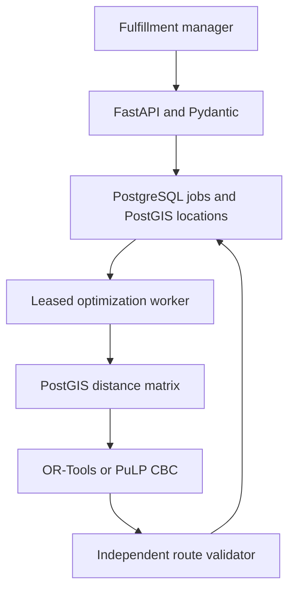

# Automated Fleet Route & Supply Chain Optimization Engine

Python logistics service that solves the **Capacitated Vehicle Routing Problem with Time Windows (CVRPTW)** and stores vehicle/driver manifests. Uses **FastAPI, Pydantic, PostgreSQL/PostGIS, Google OR-Tools**, and an actual **PuLP/CBC mixed-integer linear program** for small instances.

Submit a batch, receive HTTP 202 with a job ID, and poll for optimized routes. Solvers run in independent worker processes against a durable PostgreSQL queue, with leases and retry fencing. Source, deployment configuration, tests, sample payloads, raw results, and resume points are included.

## Architecture



- **Ingestion:** validates finite coordinates, positive weights/service times, windows/shifts, unique order/vehicle/driver IDs, fleet limits and solver selection. Job/location/fleet records commit together.
- **Spatial storage:** WGS84 geography points with a GiST index; `ST_Distance` builds the pairwise meter matrix. A fixed road factor approximates road distance; travel time uses constant speed.
- **Optimization:** all customers mandatory, one depot/trip per vehicle, capacity, service windows, waiting, shift end, and maximum total working time. Objective: modeled fuel + driver working time + fixed dispatch cost.
- **Dispatch:** workers claim with `FOR UPDATE SKIP LOCKED`. Lease token fencing prevents stale workers from replacing newer results. Result and relational route/stop manifests commit atomically.
- **Verification:** recomputes feasibility, complete coverage, driver assignments, schedules, distances, and costs independently from the route sequences before storing a successful result.

## Two solver modes

| Mode | Implementation | Scope and status |
| --- | --- | --- |
| `ortools` | RoutingModel, capacity/time dimensions, parallel cheapest insertion + guided local search | Tested on 50/100/150 stops; returns a feasible heuristic solution without a global optimality proof. API input cap: 200 stops, 30 vehicles. |
| `milp` | PuLP binary arc variables + CBC | Actual mixed-integer linear programming formulation; capped at 12 stops, 5 vehicles. Distinguishes proven optimum, time-limited incumbent, proven infeasibility and no solution found. |

See [the mathematical model](docs/MATHEMATICAL_MODEL.md) for the objective, constraints, time propagation/subtour handling, integer cost scaling, and exact solver-status interpretation. OR-Tools RoutingModel is not described as an LP solver.

## Start with Docker Compose

Requirements: Docker Engine/Desktop and Compose v2. Python 3.10+ for host-side benchmark scripts (the Docker image uses Python 3.12).

```bash
unzip fleet-route-engine.zip
cd fleet-route-engine
docker compose up -d --build --scale worker=2
curl http://localhost:8081/health/ready
```

Submit the included 100-stop batch:

```bash
curl -X POST http://localhost:8081/jobs \
  -H 'Content-Type: application/json' \
  -H 'Idempotency-Key: batch-100-001' \
  --data-binary @data/example-100.json
```

Copy the returned job ID:

```bash
curl http://localhost:8081/jobs/JOB_ID
```

- Interactive API documentation: `http://localhost:8081/docs`.
- Tiny MILP example: submit `data/example-milp.json` with a different idempotency key.
- Repeat the same payload/key to retrieve the same job; a changed payload with the same key returns 409.
- `docker compose logs --tail 50 worker` shows dispatcher/solver logs.
- `docker compose down` stops containers while retaining the database volume.

The API intentionally uses port **8081** so it can coexist with Project 1 on port 8080.

## Payload units and response

The examples contain a depot, orders, vehicle/driver IDs, capacities, shifts and costs. All times are **integer seconds from the scenario's reference time**; weights are integer kg, coordinates are decimal degrees, speed is km/h. Each time window constrains service start. Early arrival is permitted with waiting; service can finish after the window ends. Return to depot must satisfy shift and total-work bounds.

```json
{
  "depot": {"lat": 18.5204, "lon": 73.8567},
  "orders": [{"id": "order-1", "location": {"lat": 18.53, "lon": 73.86}, "demand_kg": 5, "window_start": 0, "window_end": 7200, "service_seconds": 120}],
  "vehicles": [{"id": "truck-1", "driver_id": "driver-1", "capacity_kg": 50, "shift_start": 0, "shift_end": 28800, "max_work_seconds": 28800, "fuel_cost_per_km": 0.3, "driver_cost_per_hour": 18, "fixed_dispatch_cost": 5}],
  "speed_kmh": 35,
  "road_factor": 1.3,
  "solver": "ortools",
  "time_limit_seconds": 5
}
```

| Endpoint | Response |
| --- | --- |
| `POST /jobs` | 202 durable job receipt; requires `Idempotency-Key`; 422 invalid input; 409 conflicting reuse; 503 database unavailable. |
| `GET /jobs/{uuid}` | QUEUED, RUNNING, SUCCEEDED, NO_SOLUTION, or FAILED, with attempt count and result/error. |
| `GET /health/live` | API process liveness. |
| `GET /health/ready` | Database, PostGIS, and job-table readiness; does not guarantee an active worker. |

A successful result includes vehicle/driver IDs, ordered stops, arrival/service/departure times, waiting, load, return time, distance, modeled cost, solver status, feasibility audit, baseline comparison, and the distance matrix used. NO_SOLUTION is not a partial dispatch. Search timeout without a solution is not automatically a mathematical proof of infeasibility.

## Testing

Host unit tests:

```bash
python -m venv .venv
# Linux/macOS; Windows: .venv\Scripts\activate
. .venv/bin/activate
pip install -r requirements.txt
python -m pytest -q tests/test_routing.py
```

Integration tests must run on an **idle dedicated database**, with workers stopped: dispatcher tests isolate leases by terminalizing queued fixtures. Do not run them against a live workload.

```bash
docker compose stop worker
docker compose --profile tests run --rm tests
docker compose up -d --scale worker=2 worker
```

For native development, set `DATABASE_URL`, install PostgreSQL/PostGIS, run `python -m app.cli migrate`, and start:

```bash
python -m uvicorn app.api:app --host 127.0.0.1 --port 8081
# In another terminal:
python -m app.worker
```

The delivered **16 tests passed**. Coverage includes both solvers' capacity/time/shift constraints, mandatory coverage, waiting, impossible instances, malformed/nonfinite payloads, tampered schedules, the deterministic baseline, real PostGIS distance calculations, concurrent ingestion idempotency, stale-worker token fencing, atomic manifest writes, and API validation. For the four-stop fixture, CBC's proven optimum matches exhaustive route enumeration.

## Reproduce measurements

With the API, PostGIS, and workers running:

```bash
python -m scripts.benchmark --output results/reproduction
```

Runs nine deterministic synthetic instances: 50, 100 and 150 destinations, each with seeds 42, 43 and 44, five-second OR-Tools search limits. Saves full payloads, result manifests, distance matrices, independent audits and a summary. Each request uses a new idempotency key. Benchmarks compare fully feasible routes using the same data and matrix.

Generate a custom scenario:

```bash
python -m scripts.generate --orders 100 --seed 42 --output data/my-batch.json
```

Lease recovery on an idle demo stack:

```bash
python -m scripts.recovery
```

The recovery script stops normal workers, injects a worker exit after claim with a five-second lease, restarts workers and checks completion on attempt two. Do not use crash flags during ordinary operation. The measured native recovery test additionally queried the database to verify exactly four unique stop records.

## Measured outcomes and resume points

Tested on **2026-10-09 UTC** using a real native FastAPI HTTP API, PostgreSQL **16.15**, PostGIS **3.4.2**, OR-Tools **9.12**, and two worker processes. The HTTP benchmark submitted one job at a time.

**Nine batches / 900 destinations**, including **150-stop batches**: **17.5858% aggregate modeled distance reduction**, **16.4648% median per-case distance reduction**, and **10.0037% median modeled operational cost reduction**, against a fully feasible nearest-next-stop baseline. All optimized manifests passed the independent validator with **zero observed capacity, service-window, shift or order-coverage violations**.

| Stops | Seed | Baseline km | Optimized km | Distance reduction | Modeled cost reduction | Job wall time (s) |
| ---: | ---: | ---: | ---: | ---: | ---: | ---: |
| 50 | 42 | 144.674 | 108.587 | 24.94% | 17.06% | 5.243 |
| 50 | 43 | 141.501 | 106.245 | 24.92% | 16.92% | 5.243 |
| 50 | 44 | 142.131 | 106.510 | 25.06% | 17.08% | 5.150 |
| 100 | 42 | 205.533 | 172.980 | 15.84% | 9.82% | 5.320 |
| 100 | 43 | 203.512 | 170.581 | 16.18% | 10.00% | 5.262 |
| 100 | 44 | 201.788 | 168.564 | 16.46% | 8.25% | 5.169 |
| 150 | 42 | 272.268 | 239.358 | 12.09% | 7.06% | 5.299 |
| 150 | 43 | 268.742 | 228.201 | 15.09% | 8.80% | 5.306 |
| 150 | 44 | 284.836 | 235.987 | 17.15% | 10.24% | 5.321 |

- OR-Tools solve times: **5.001–5.006 seconds**, using the same five-second configured search budget in each case.
- HTTP job admission times: **16.835–44.891 ms**. These are nine individual samples, not throughput or a p95 benchmark.
- End-to-end job wall time: **5.150–5.321 seconds**, including admission, queue polling, matrix calculation, solve, manifest persistence and client polling.
- Small PostGIS-backed MILP: **4 stops, 2 vehicles, 54 variables, 88 constraints**, proven optimal modeled cost **25.3495** in **0.359 seconds** in the measured API run.
- Worker crash after claiming a job: process exited with code 42; a five-second lease expired; another worker completed attempt 2 with **4 unique persisted stops**.
- The 16-test suite passed; the separate four-stop mathematical fixture matched an exhaustive optimum. The API MILP example uses a real PostGIS matrix and is a different numerical instance from the unit fixture.

**Interpretation:** all benchmarks are deterministic synthetic coordinates with broad 4/6-hour windows, a constant 1.3 road factor, 35 km/h speed, and 8-hour shifts. These figures quantify modeled routing performance against this baseline, not observed real delivery fuel savings. OR-Tools results are feasible heuristic solutions, without an optimality proof. Mileage improvements varied from **12.09% to 25.06%**; the aggregate percentage is weighted by baseline distance, not an arithmetic mean.

**Resume bullets (use after running and understanding the project):**

- **Built an asynchronous fleet-routing engine with FastAPI, PostgreSQL/PostGIS, and OR-Tools, producing independently validated schedules for up to 150 destinations within five-second search budgets in local synthetic tests.**
- **Reduced aggregate modeled delivery distance by 17.6% versus a feasible nearest-stop baseline across nine batches totaling 900 destinations, with zero observed capacity, time-window, or shift violations.**
- **Formulated a PuLP/CBC CVRPTW MILP and verified its small-instance optimum against exhaustive enumeration; implemented durable job leases, idempotent ingestion, and fenced worker-crash recovery.**

Project title: **Fleet Route Optimization Engine | Python, FastAPI, OR-Tools, PuLP/CBC, PostgreSQL/PostGIS, Docker**.

Do not claim globally optimal 150-stop solutions, live traffic routing, 18% observed real mileage savings, elimination of violations from an infeasible baseline, or production HA. Docker execution was not tested here.

Raw evidence: `results/measured/` has each payload, complete result/manifest/matrix and summary; `results/integration-tests.txt`, `results/recovery.json`, `results/milp-example.json`, `results/database-evidence.json`, and the full run log record the validation and native database versions.

## Important assumptions

These are **synthetic modeled distances**, using PostGIS spheroidal distances times a constant factor, not observed delivery mileage. The baseline is an already feasible nearest-next-stop planner; zero time-window violations means optimized schedules remained feasible, not that an invalid baseline was repaired. Driver wages include waiting and service. Cost is one abstract currency with explicit quantization, not real accounting savings.

The service does not implement live traffic, a road graph, multiple depots/trips, pickups, order splitting, charging, rest breaks, statutory driver-rule compliance, authentication, tenant isolation, or database HA. Broad benchmark windows and binding-window unit cases are described separately. Docker configuration is included and YAML-validated; the delivered tests used native processes rather than Docker. See [operations and failure behavior](docs/OPERATIONS.md) and `results/ENVIRONMENT.md` for exact limits.

## Layout

```text
app/models.py          Pydantic input constraints
app/api.py             FastAPI submission/status endpoints
app/db.py              PostGIS, durable queue, leases, fenced completion
app/schema.sql         Jobs, geography locations, fleet, routes, stops
app/routing.py         OR-Tools, baseline, manifest and independent audit
app/milp.py            PuLP/CBC binary arc formulation
app/worker.py          Asynchronous optimizer process
scripts/               Scenario generator, HTTP benchmark, crash recovery
tests/                 Mathematical, API and database tests
data/                  Ready-to-submit 100-stop and small MILP examples
results/               Actual measurements and evidence
docs/                  Mathematical model and operational assumptions
```

## Primary references

- [OR-Tools time-window routing](https://developers.google.com/optimization/routing/vrptw)
- [OR-Tools dimensions](https://developers.google.com/optimization/routing/dimensions)
- [PostGIS ST_Distance](https://postgis.net/docs/ST_Distance.html)
- [PuLP documentation](https://coin-or.github.io/pulp/)
